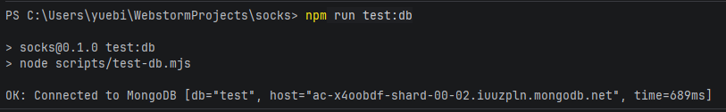
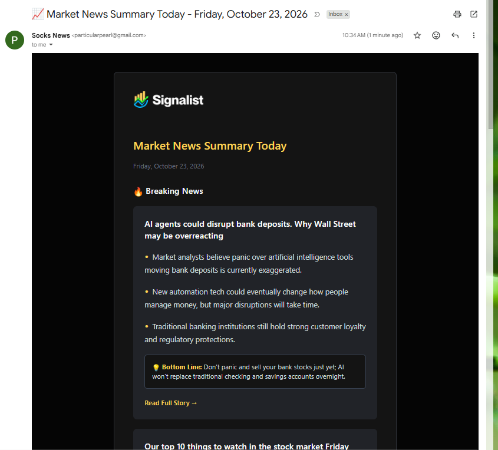
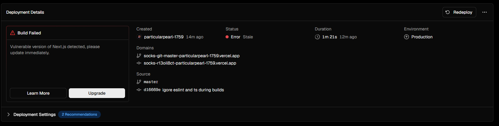
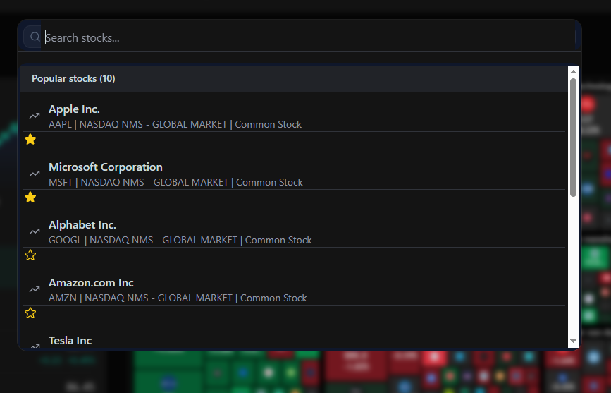
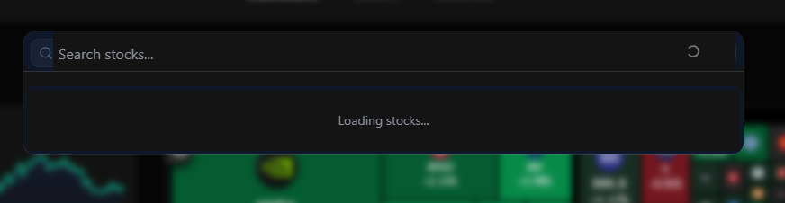
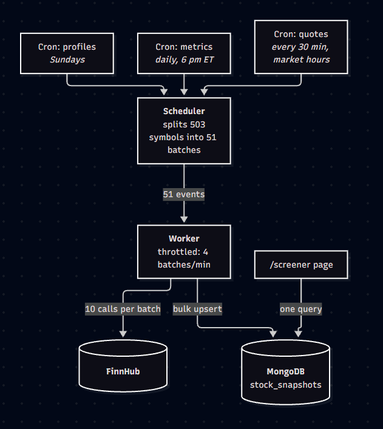

# Socks

Socks is a s(t)ock market application, without the T (as in ``T``aste of a bad UI). We do have much market differentiation.

## Building Socks

Several tools and languages were used throughout development, including the programming languages:
- Typescript
- Next.JS
- React

as well as:
- **TradingView**, for its industry-standard stock market widgets
- **ShadCN**, a beautiful components library
- **CodeRabbit**, an AI pull request reviewing tool 
- **MongoDB Atlas**, the cloud-based database
- **Better Auth** for authentication logic
- **Inngest** for streamlining async code
- **Nodemail** for the app's email communications
- **Google AI Studio** to personalize content for users
- **Finnhub API** for stock market data

There were several major parts to Socks' development, as described below.

### Version 1

The initial version of the app laid the foundational groundwork for more a more complex stock screener application. Specifically, this version set in place a user authentication system, homepage, watchlist, and stock search functionalities (without filters/screening capabilities yet). We also enabled email communication.

Parts 1-8 and 11 as described below were built following this tutorial: https://www.youtube.com/watch?v=gu4pafNCXng. Regarding AI usage in this part - while Junie, an AI coding tool, was utilized throughout the video, Socks was developed without using it. Claude Code was used minimally for debugging purposes.

#### Part 0: The Logo
It was initially difficult to envision Socks' logo, until the realization that it could simply be two Socks placed stylishly, one upon the other.

For this, Pixlr was used. The result is below:


#### Part 1: Layout and Header Setup

To cleanly develop Socks' layout so it was reusable and scalable, we incorporated the following during the development of Socks' primary layout and headers setup:
- React's App Router feature, for simpler and scalable page URLs
- A separate `constants.ts` file to detach some style or settings variables for our application from the interface code itself (in considering the 'separation of concerns' principle)

#### Part 2: Homepage

Our homepage includes four TradingView stock market widgets. 

The widgets themselves are stored under the `@/components` directory and loaded in through `useTradingViewWidget` (implemeted in file `useTradingViewWidget.tsx`), a React hook for loading embedded `TradingViewWidgets` into application.

Note here that all the components for our website are added under the `@/components` directory first, and then loaded into the specific pages they are used, in order to maximize reusability and reduce repetition.


#### Part 3: Auth UI & Layout

To begin with, while not being exclusive to this part in terms of its functionality, we created a globally accessible `types` directory and `global.d.ts` file for storing types which are usable across the entire project.

For our sign-in and sign-up forms, we utilized the React hook-centered open-source library React Hook Form, a third party package which enables us to validate and manage the state of our forms.

For our input fields, we created reusable `InputField.tsx`, `SelectField.tsx`, and `CountrySelectField.tsx` components under the `components` directory.

The resulting forms appeared like the below:


#### Part 4: The Database

This app uses the cloud-based MongoDB Atlas, communicating with the database via the ORM Mongoose. Crucially, in `mongoose.ts`, we implemented a new singleton-style Mongoose connector with a global cache which exports `connectToDatabase`.

To validate, we used CLI testing by creating the new script `test:db`. This succeeded, as apparent by the console log below:



#### Part 5: Authentication Logic

In this part, we integrated the following tools:
- BetterAuth for user authentication
- Inngest + Nodemailer to asynchronously send users emails.
- MongoDB Atlas for our database, to store user information

The result was completed functionality for user sign up and sign in, wih the added perk of user email communication amongst important events (such as successful user sign up).

##### Bugs/Issues
One issue we ran into was as in `auth.ts`, where when creating the singleton `authInstance`, there were incompatible types between what was being passed as props when initializing it to a new `betterAuth` object versus what `betterAuth` expected. Initially, `authInstance` was initialized in the following way:
```typescript
let authInstance: ReturnType<typeof betterAuth> | null = null;
```
```typescript
authInstance = betterAuth({
    database: mongodbAdapter(db),
    secret: process.env.BETTER_AUTH_SECRET,
    baseURL: process.env.BETTER_AUTH_URL,
    emailAndPassword: {
    enabled: true,
    disableSignUp: false,
    requireEmailVerification: false,
    minPasswordLength: 8,
    maxPasswordLength: 128,
    autoSignIn: true,
    },
    plugins: [nextCookies()],
});
```
The issue was at its root due to BetterAuth being of newer version than what we'd presumably coded with. We resolved it by instead instantiating authInstance through a new `createAuth` function so TypeScript could infer the exact return type:
```typescript
const createAuth = (db: Db) =>
    betterAuth({
        database: mongodbAdapter(db),
        secret: process.env.BETTER_AUTH_SECRET,
        baseURL: process.env.BETTER_AUTH_URL,
        emailAndPassword: {
            enabled: true,
            disableSignUp: false,
            requireEmailVerification: false,
            minPasswordLength: 8,
            maxPasswordLength: 128,
            autoSignIn: true,
        },
        plugins: [nextCookies()],
    });
```

#### Part 6: Daily News Summary

We implemented the following four-step workflow to enable email-based communication of daily news summaries for users:
1. Schedule async workflow with Inngest, retrieving all users who are on mailing list
2. For each user, customize email based on their watch list symbols
3. Personalize digest further via Gemini AI
4. Send out emails via NodeMailer

The result is a customized daily news summary sent out to all users, which looks something like the below:


In a later feature add (not part of the tutorial followed), we enabled the functionality for users to unsubscribe to emails.

#### Part 7: Search Functionality

To enable users to search for stocks, we used Finnhub's Stock API to pull data on tickers.

#### Part 8: Stock Details

We added functionality enabling users to view a detailed information page for specific stocks. The implementation for this part actually came out quite similar compared to building our Watchlist tab, as we put together several TradingView widgets to build out our page. Due to our having set up the components => pages workflow in prior parts, adding in new TradingView widgets for our page was relatively straighforward.

#### Part 9: Deployment

Vercel was used for deployment. The only minor issue we ran into here was a Next.js version vulnerability, which was fixed through the PR `Fix React Server Components CVE vulnerabilities` with auto-generated change suggestions from Vercel:


#### Part 10: Google Auth 

Through Google Cloud, we enabled users to be able to authenticate, sign themselves up, or link existing accounts to Google.

Note for this part, we also needed to verify our domain via Google Search Console, for which we added the Google URL suffix file under our `public/` 

#### Part 11: Watchlist CRUD

Under the `Watchlist` tab, users can view information on their list of starred stocks. Stocks can be added/removed from the watchlist through either the search bar pop-up or directly on the `Watchlist` page. 

Info on watchlist stocks are currently stored in a single MongoDB collection across all users (plainly named `watchlist`). Each document in `watchlist` consists of the `userId` of the account adding the stock to their watchlist, as well as the ticker symbol. When users open their `Watchlist` page, all documents from the collection are pulled out and filtered until only those with matching `userId` remain. Finally, the filtered list of watchlist stocks are displayed via a rendered `WatchlistTable` component.

## Version 2

Our focus in this upgrade was twofold: firstly, adding stock screening capabilities and secondly, improving speed/performance. Finally, we also made some minor patches. 

For Version 2, I used Claude Code to discuss high-level architecture options on performance (i.e. perceived speed, optimization techniques) or screener (e.g. where filtering should happen and how to cache Finnhub responses), with the implementation and final decisions made on my own.

### Performance

On performance, we made code changes in line with the following considerations:
- To increase the perceived speed of the application, we added the `loading.tsx` component (we didn't place it in the `components` directory because it's not quite a component which needs to be refactored across uses). This way, as soon as a user clicks on anything, the `loading` component is shown instantly while the page loads on the server
- In `lib/better-auth/auth.ts`, we cache the MongoDB session data (which could contain info on things like remote sign-outs or direct database edits), only re-fetching each 5 minutes. This way, our application is not slowed by repeated MongoDB requests. The tradeoff here is, ofcourse, stale data; however, BetterAuth changes are safe as `updateUser` rewrites the cookies immediately so onboarding still works properly
    - Note here that `BetterAuth` is not a database or data store of any type but simply a library which then propagates necessary DB changes to MongoDB
- For the search bar, we currently fetch FinnHub data as soon as the user opens up `Search`/before they search anything. Then each unique/new search the user types in is given to FinnHub, with old searches cached. Now to increase initial load-up speed of the bar, we instantly load the bar first and show `loading` until data is successfully fetched for which it then appears/replaces the `loading` status
    - Before: 
    - After: 
- Individual stock pages may possibly be slowed by the loading of their watchlist buttons (since pages are always as slow as their slowest synchronous component). To mitigate this, we can simply bring out the watchlist button to its own async component, `StockWatchlistButton`, and load it into `StockDetails`.
- For the `useTradingViewWidget.tsx`, we implemented lazy loading so charts load once they scroll into view, instead of slowing down the entire page as soon as the user lands on it

### Screener

Our screener is a separate tab in our application, just like 'search' and 'watchlist'. As a whole, we implemented it in two parts:
- **Browse**. The 'landing page' of our screener tab is a list of stocks the user can browse. It consists of a selection of stocks from the ones we allow users to screen from.
- **Screener/Filter**.

#### Browse Architecture

The architecture consists of a read-based model which is filled asynchronously in the background:



Several considerations were made when designing the architecture:
- Separating reading from writing
  - Prevents either from delaying the other
- Batching for requests
  - We have 3 types of requests (stock prices, stock profiles, metrics) x 500 stocks = 1,500 requests total
  - The scheduler splits our FinnHub data requests into batches of size 10; the worker sends out at most 4 batches/min
  - This helps with
    - Staying within FinnHub and Inngest rate limits
      - FinnHub has a limit of 60 requests per min
      - Inngest has a limit of 4 batches per min
    - Small batches = only need to redo a smaller portion of the work if one request fails

#### Browse File Structure

All of our main browse or screener-related files which we added when building the browse functionality were part of one of five groups.
- Pulling the universe of stocks
  - Files:
    - `scripts/update-sp500.mjs`
    - `data/sp500.json`
    - `lib/screener/universe.ts`
  - For the workflow, `update-sp500.mjs` downloads the S&P 500 list to `sp500.json`, and `universe.ts` exposes this list to our app
- Protocols on data we pull for the stocks
  - `database/models/stock-snapshot.model.ts` outlines the MongoDB document per stock
- Background data syncing
  - Files
    - `lib/screener/finnhub.ts`
    - `lib/screener/sync.ts`
    - `lib/inngest/screener.ts`
    - `app/api/inngest.route.ts`
    - `scripts/screener.preview.ts`
  - We call Finnhub via `finnhub.ts`, which passes the data to `sync.ts` to convert then to fields and save it.
  - `screener.ts` schedules the syncs and throttles them and `inngest.route.ts` registers those jobs with Inngest
  - `screener.preview.ts` checks the current mappings against live data
- Page logic
  - Files
    - `lib/screener/catalog.ts`
    - `lib/screener/state.ts` 
    - `lib/screener/query.ts`
    - `lib/screener/repository.ts`
  - `query.ts` receives the URL's search params from `screener/page.tsx`, parsing and validating them into a `ScreenerState`. Then, `repository.ts` uses `toMnogo` and `effectiveSort` from `query.ts` to run the database query. The table renders the results, and its links come from `hrefWith` in `state.ts`.
- UI
  - Files:
    - `app/(root)/screener/page.tsx`
    - `components/screener/ScreenerControls.tsx`
    - `components/screener/ScreenerTable.tsx`
    - `components/screener/ScreenerPagination.tsx`
  - `screener/page.tsx` receives the URL's search params (passing them to `query.ts`) and pulls the screener controls, table, and pagination components from the `components/screener` directory