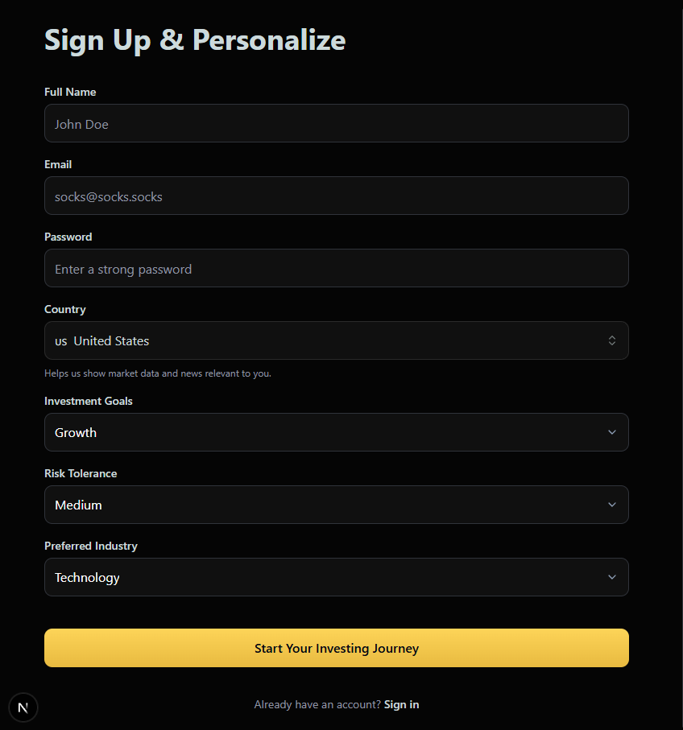
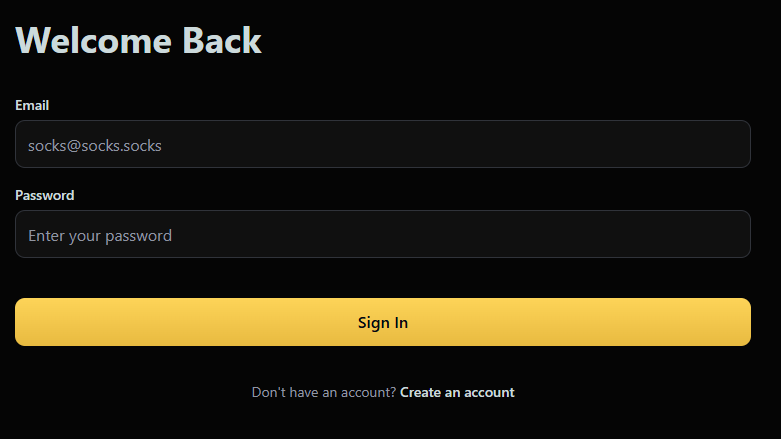

# Socks

Socks is a s(t)ock market application, without the T (as in ``T``aste of a bad UI). We do have much market differentiation.

## Building Socks

This app was initially built following this tutorial: https://www.youtube.com/watch?v=gu4pafNCXng. Several tools and languages were used in its development, including the programming languages:
- Typescript
- Next.JS
- React

and the tools:
- **TradingView**, for its industry-standard stock market widgets
- **ShadCN**, a beautiful components library
- **CodeRabbit**, an AI pull request reviewing tool 

There were several major parts to Socks' development, as described below.

### Part 0: The Logo
It was initially difficult to envision Socks' logo, until the realization that it could simply be two Socks placed stylishly, one upon the other.

For this, Pixlr was used. The result is below:

### Part 1: Layout and Header Setup

To cleanly develop Socks' layout so it was reusable and scalable, we incorporated the following during the development of Socks' primary layout and headers setup:
- React's App Router feature, for simpler and scalable page URLs
- A separate `constants.ts` file to detach some style or settings variables for our application from the interface code itself (in considering the 'separation of concerns' principle)

### Part 2: Homepage

Our homepage includes four TradingView stock market widgets. 

The widgets themselves are stored under the `@/components` directory and loaded in through `useTradingViewWidget` (implemeted in file `useTradingViewWidget.tsx`), a React hook for loading embedded `TradingViewWidgets` into application.

Note here that all the components for our website are added under the `@/components` directory first, and then loaded into the specific pages they are used, in order to maximize reusability and reduce repetition.

### Part 3: Auth UI & Layout

To begin with, while not being exclusive to this part in terms of its functionality, we created a globally accessible `types` directory and `global.d.ts` file for storing types which are usable across the entire project.

For our sign-in and sign-up forms, we utilized the React hook-centered open-source library React Hook Form, a third party package which enables us to validate and manage the state of our forms.

For our input fields, we created reusable `InputField.tsx`, `SelectField.tsx`, and `CountrySelectField.tsx` components under the `components` directory.

The resulting forms appeared like the below:

